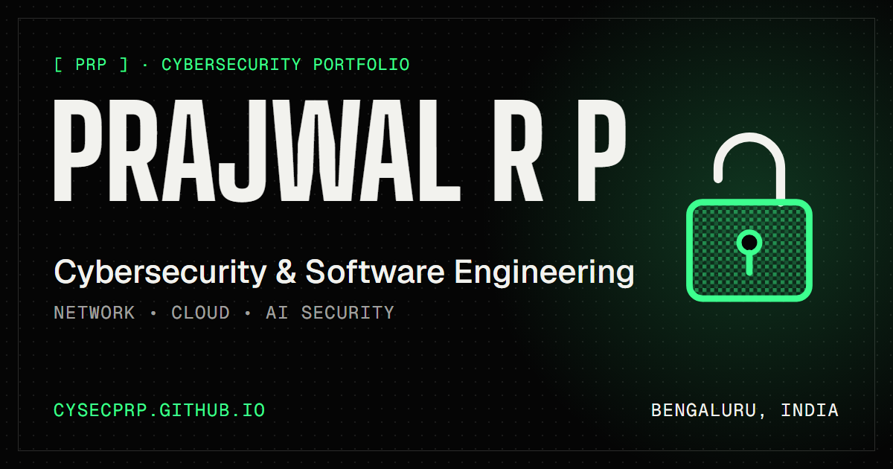

# Prajwal R Pattanshetti — Portfolio

My cybersecurity portfolio, live at **[cysecprp.github.io](https://cysecprp.github.io/)**.

[](https://cysecprp.github.io/)

## Highlights

- WebGL padlock drawn with an ordered-dither shader; it follows the cursor and unlocks on hover
- Interactive terminal with built-in commands and three hidden flags to capture
- Scroll-driven animations (GSAP + Lenis), letter magnify and text scramble effects, all switched off for visitors who prefer reduced motion
- A case-study page for every project, plus a printable resume
- Strict Content Security Policy, no cookies and no trackers
- Every page ships its own title, description and social preview tags, and the sitemap is generated at build time

## Tech stack

React 19 · TypeScript · Vite · React Router · GSAP · Lenis · WebGL · d3-geo · oxlint

## Run locally

Requires Node.js 22.12 or newer.

```bash
npm ci
npm run dev      # http://localhost:5173
npm run lint
npm run build    # outputs dist/
npm run preview  # serves the production build
```

## Deployment

Every push to `main` is linted, built and deployed to GitHub Pages by [deploy.yml](.github/workflows/deploy.yml). Pull requests, including Dependabot updates, are checked by [ci.yml](.github/workflows/ci.yml).

The contact form posts to the URL in the `VITE_CONTACT_ENDPOINT` repository variable (a Formspree form). Without it, the form opens the visitor's email app instead.

## Social preview image

`public/og-image.png` is rendered from [scripts/og-image.html](scripts/og-image.html). After editing the template, regenerate the image from the repository root (after `npm ci`, so the fonts resolve):

```powershell
& "${env:ProgramFiles(x86)}\Microsoft\Edge\Application\msedge.exe" --headless --hide-scrollbars --window-size=1200,630 --allow-file-access-from-files --virtual-time-budget=4000 --user-data-dir="$env:TEMP\og-edge" --screenshot="$PWD\public\og-image.png" "file:///$($PWD -replace '\\', '/')/scripts/og-image.html"
```

## License

© 2026 Prajwal R Pattanshetti. All rights reserved.
