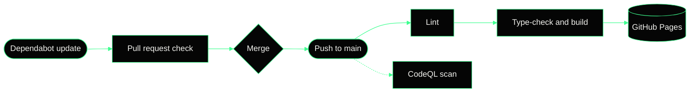

 

<samp>[ PRP ] · SECURING SYSTEMS FROM PACKET TO CLOUD</samp>

  

  

<samp><a href="https://cysecprp.github.io/">Live site</a> · <a href="https://cysecprp.github.io/projects">Projects</a> · <a href="https://cysecprp.github.io/resume">Resume</a> · <a href="https://cysecprp.github.io/#lab">Lab</a> · <a href="https://cysecprp.github.io/#contact">Contact</a></samp>

 

Cybersecurity engineering student and software engineering intern, based in Bengaluru. This repository is the source of my portfolio: a dark, terminal-flavoured site where the hero is a dithered WebGL padlock, a working shell is one click away and three flags are hidden for the curious.

<samp>DETECT ✳ ANALYZE ✳ DEFEND</samp>

## <samp>[ 01 / 05 ]</samp> · Inside the site

<table>
  <tr>
    <td width="50%" valign="top">
      <samp>01 · DITHERED PADLOCK</samp> 
      A WebGL padlock drawn with an ordered-dither shader. It follows your cursor and springs open on hover.
    </td>
    <td width="50%" valign="top">
      <samp>02 · LIVE TERMINAL</samp> 
      A working shell with built-in commands and tab completion, ready to open from anywhere on the site.
    </td>
  </tr>
  <tr>
    <td width="50%" valign="top">
      <samp>03 · CAPTURE THE FLAG</samp> 
      Three hidden flags are tucked into the site. The footer keeps score.
    </td>
    <td width="50%" valign="top">
      <samp>04 · MOTION</samp> 
      Scroll choreography with GSAP and Lenis, letter magnify and text scramble, all switched off for visitors who prefer reduced motion.
    </td>
  </tr>
  <tr>
    <td width="50%" valign="top">
      <samp>05 · CASE STUDIES</samp> 
      A dedicated page for every project, plus a printable resume.
    </td>
    <td width="50%" valign="top">
      <samp>06 · PRIVATE BY DESIGN</samp> 
      No cookies, no trackers and a strict Content Security Policy. Every page ships its own search and social preview tags.
    </td>
  </tr>
</table>

## <samp>[ 02 / 05 ]</samp> · Featured work

|                 | Project                                | What it is                                                                             | Links                                                                                                                                                                            |
| :-------------- | :------------------------------------- | :------------------------------------------------------------------------------------- | :------------------------------------------------------------------------------------------------------------------------------------------------------------------------------- |
| <samp>01</samp> | **ZT-DT — Zero-Trust Digital Twin**    | Real-time anomaly detection for industrial cyber-physical systems, published with IEEE | [Case study](https://cysecprp.github.io/projects/zt-dt) · [Code](https://github.com/CYSECPRP/zt-dt-industrial-cps) · [Paper](https://doi.org/10.1109/NMITCON65824.2025.11188236) |
| <samp>02</samp> | **DeepGuard**                          | AI-powered defense against deepfake identity fraud                                     | [Case study](https://cysecprp.github.io/projects/deepguard) · [Code](https://github.com/CYSECPRP/deepguard-ai-defense)                                                           |
| <samp>03</samp> | **Web Application Security Scanner**   | OWASP-aligned vulnerability assessment with severity-rated reports                     | [Case study](https://cysecprp.github.io/projects/web-security-scanner) · [Code](https://github.com/CYSECPRP/Professional-Web-Application-Security-Scanner)                       |
| <samp>04</samp> | **Network Scanner**                    | ARP host discovery and TCP SYN port scanning with Scapy                                | [Case study](https://cysecprp.github.io/projects/network-scanner) · [Code](https://github.com/CYSECPRP/Network-Scanner)                                                          |
| <samp>05</samp> | **Network Security & System Analysis** | Hands-on traffic analysis and vulnerability research                                   | [Case study](https://cysecprp.github.io/projects/network-security-analysis)                                                                                                      |
| <samp>06</samp> | **Password Strength Meter**            | Angular component with zxcvbn-based strength estimation                                | [Case study](https://cysecprp.github.io/projects/password-strength-meter) · [Code](https://github.com/CYSECPRP/password-strength-meter-angular)                                  |

## <samp>[ 03 / 05 ]</samp> · Built with

  
  
  
  
  
  
  
  
  
  
  

## <samp>[ 04 / 05 ]</samp> · How it ships

Every change to `main` is linted, type-checked, built and published automatically. Dependency updates arrive as pull requests and must pass the same checks before they are merged.

## <samp>[ 05 / 05 ]</samp> · Security

- **Strict by default** — a Content Security Policy allows scripts, styles and fonts only from the site itself, with no inline scripts, no cookies and no trackers.
- **Pinned supply chain** — every GitHub Action is pinned to a full commit SHA, and Dependabot keeps dependencies current and patches known vulnerabilities.
- **Continuously scanned** — CodeQL code scanning, plus secret scanning with push protection.
- **Protected history** — `main` cannot be force-pushed or deleted.
- **Responsible disclosure** — found something? Please report it privately as described in [SECURITY.md](SECURITY.md).

 

<samp>© 2026 PRAJWAL R PATTANSHETTI · ALL RIGHTS RESERVED · <a href="LICENSE">LICENSE</a></samp>
 
<samp>DESIGNED &amp; BUILT IN BENGALURU · 12.97°N · 77.59°E</samp>

